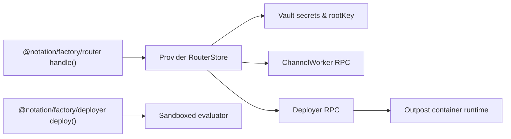

# Hub Providers

A hub provider implements `Vault`, `Router`, and `Deployer` from `@notation/factory`. It connects Notation Factory's portable router and deployer cores to a hosting platform's compute, storage, and secret store.

## Implementing `Vault`

`Vault` in `contracts/vault.ts` creates write-only credential entries scoped to the hub's secret store and returns opaque `VaultSecret` groups:

| Member | Responsibility |
| :--- | :--- |
| `provider` | Provider identifier string matched by `Router` and `Deployer` |
| `secret` | Accepts `VaultSecretOptions` with `id` and `value`, returning a `VaultSecret` |

Both `Router` and `Deployer` should verify that passed secrets belong to a matching vault instance using a type guard such as `assertCloudflareSecret` before binding them.

## Implementing `Router`

A `Router` group exposes platform storage and worker bindings to connection and code host plugins while delegating HTTP routing to `handle` in `@notation/factory/router`:

| Member | Purpose |
| :--- | :--- |
| `url` | `OutputRef<string>` resolving to the deployed router origin |
| `store` | `RouterConfigStore` collecting `connections`, `codeHost`, and `operators` entries |
| `vault` | The provider `Vault` passed in constructor options |
| `rootKey` | `VaultSecret` wrapping a 32-byte `RandomKey`, bound as `FACTORY_ROOT_KEY` |
| `codeHost` | Mutable slot set by the hub's `CodeHost` constructor; throws if declared twice |
| `bind` | Binds a `VaultSecret` to the router runtime and returns its binding name |
| `channel` | Deploys a `ChannelModule` with bound `secrets` and `values` and updates `connections` |

When `bind` omits a custom `name`, derive the binding name with `bindingName` from `@notation/factory`.

To configure webhooks and redeploy repositories on `notation deploy`, declare a 32-byte `RecordedKey` bound as `FACTORY_SYNC_KEY`.

Pair that key with a `RouterSync` resource wired to `this.url` and `syncKey.outputRef("Value")`.

In the router's HTTP entrypoint, build a `RouterStore` adapter for `@notation/factory/router`:

| Property | Purpose |
| :--- | :--- |
| `inbox` | `Inbox` instance deduplicating deliveries, advancing them asynchronously, noting runs' heartbeats, and supporting replay |
| `deploys` | `DeployLog` persisting latest deploy statuses and container build states |
| `rootKey` | Async getter returning the bound `FACTORY_ROOT_KEY` value |
| `syncKey` | Optional async getter returning the bound `FACTORY_SYNC_KEY` value |
| `channel` | Lookup returning a `RemoteChannel` for a connection's channel binding |
| `deployer` | Optional `RemoteDeployer` RPC client for deploys, worktrees, and runs |

The inbox triggers `advance(record, store)` asynchronously via alarms or queues and retains seen delivery IDs and failed deliveries for `KEEP_DELIVERY_MS`. It saves what `heartbeatWatch` returns for each heartbeat apart from the record, and calls `watch(record, watches, store)` within `LOST_AFTER_MS` of each heartbeat, so that runs that stop sending heartbeats are marked lost. `watch` also resolves to whether it marked a run lost, in which case the inbox lists the delivery as failed again. `advance` and `watch` wait on the deployer and channels, and a restart or replay may save the record meanwhile, so an inbox that saves the record afterwards merges the two with `mergeRecord`.

## Implementing `Deployer`

`Deployer` owns outpost evaluation, container provisioning, image builds, and runtime secret injection.

Call `deploy` and `worktree` from `@notation/factory/deployer` with a `DeployerContext` adapter.

The context's `evaluate` handler executes ES module maps in an isolate with outbound networking disabled, such as `globalOutbound: null` on Cloudflare.

Bind platform secrets and runner endpoints before starting each container, without exposing `Connection` credentials:

| Binding | Value |
| :--- | :--- |
| `FACTORY_ROOT_KEY` | Value from `router.rootKey` |
| `FACTORY_MODULES_URL` | Base URL serving `code-host.ts` and runtime modules |
| `FACTORY_STATE_URL` | Persistent state endpoint scoped per container ID |

Also inject every `Account` secret under its declared variable name, plus matching `OutpostSecret` entries filtered with `allowsRepo`. Start executions by posting signed `Run` payloads to the container. The router watches a run from its first heartbeat, and marks it lost after 5 minutes without one. A deployer that queues runs before it starts their container posts a run's first heartbeat to `run.reply.heartbeat` as soon as it takes the run, and then one a minute until the runner takes it, as the Cloudflare outpost Worker does. Its reply for a run that it couldn't deliver has `done`, which ends the watch.
