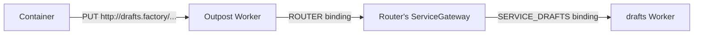

# Services

A service is a Worker that the hub runs for its containers. Every container on the hub reaches each service at `http://<name>.factory`, with no credential. The service gets each request with two headers that name the repo and the container that sent it. The hub sets these headers, and the container can't.

Factory ships no services, so each hub declares its own. This page uses a service named `drafts` as its example. Agents upload web pages to `drafts`, and the service stores them in an R2 bucket.

## Declaring a service

The hub declares the service's Worker with Notation, and passes it to `cloudflare.Service` with the router:

```ts [factory.infra.ts]
import { bundle } from "@notation/build/resources";
import { r2 } from "@notation/cloudflare/resources";
import { worker } from "@notation/cloudflare/workers";
import * as cloudflare from "@notation/factory-cloudflare";

const bucket = new r2.R2Bucket("drafts", { config: { BucketName: "drafts" } });
const drafts = worker({
  id: "drafts",
  compatibilityDate: "2026-10-12",
  code: bundle({ id: "drafts", platform: "workerd", entry: "./workers/drafts.ts" }),
  bindings: () => ({ BUCKET: bucket }),
  url: false, // <-- no public URL
});

new cloudflare.Service("drafts", { router, worker: drafts });
```

The service's id is its name, and containers reach it at `drafts.factory`. `cloudflare.Service` binds the Worker to the router Worker as `SERVICE_DRAFTS`. Outposts don't declare services, and containers don't list them. Every container on the hub can reach every service.

A service's name must be a lowercase DNS label: letters, digits and hyphens, at most 63 characters, and not starting or ending with a hyphen. It can't be `state` or `runner`, since the outpost already serves `state.factory` and `runner.factory`. `isServiceName` in `@notation/factory/router` checks a name. `cloudflare.Service` throws on a name that fails the check. Notation refuses a second binding with the same name, so a second service with the same name fails too.

## Writing the service's Worker

The service's Worker is a plain fetch handler. It reads the sender from the headers in `SERVICE_HEADERS`:

```ts [workers/drafts.ts]
import { SERVICE_HEADERS } from "@notation/factory/router";

export default {
  async fetch(request: Request, env: { BUCKET: R2Bucket }) {
    const repo = request.headers.get(SERVICE_HEADERS.repo); // <-- such as "acme/app"
    const container = request.headers.get(SERVICE_HEADERS.container); // <-- such as "dev"
    if (!repo || !container) return new Response("bad request", { status: 400 });
    const key = new URL(request.url).pathname.slice(1);
    await env.BUCKET.put(key, request.body, {
      httpMetadata: { contentType: request.headers.get("content-type") ?? undefined },
      customMetadata: { repo, container },
    });
    return new Response(null, { status: 204 });
  },
};
```

The Worker gets the request at the URL that the container used, so a container's `PUT http://drafts.factory/a1b2/index.html` arrives with the pathname `/a1b2/index.html`.

`SERVICE_HEADERS.repo` is `x-factory-repo`, and `SERVICE_HEADERS.container` is `x-factory-container`. **These headers are the only proof of who sent a request.** A service that keeps data per repo, or limits what a repo may do, should read them on every request.

The headers can be trusted only if nothing else can reach the Worker. For this reason, the `drafts` Worker sets `url: false`, so it has no workers.dev URL, and only Workers that bind it, such as the router, reach it. A service that also serves the public, such as one that publishes the drafts, should do so from a second Worker with a URL.

## Calling the service from a container

A script or an agent in the container calls the service by its host:

```js [.factory/bin/publish-draft]
await fetch(`http://drafts.factory/${prefix}/index.html`, {
  method: "PUT",
  headers: { "content-type": "text/html" },
  body,
});
```

The URL must use `http`. The outpost intercepts the container's plain HTTP requests only, and `drafts.factory` has no DNS record, so an `https` request to it fails.

## How a request reaches the service

A request from a container passes through the outpost Worker and the router before it reaches the service:



The steps are:

1. The outpost Worker's container class registers a handler for `*.factory` in `outboundByHost` from `@cloudflare/containers`. The handlers for `state.factory` and `runner.factory` match first, since exact hosts win over the glob.
2. The handler drops every header whose name starts with `x-factory-`. It sets `x-factory-repo` and `x-factory-container` from the Worker's `REPO` and `CONTAINER` vars. Each outpost Worker runs one repo's container, and the deployer sets the vars when it builds the Worker.
3. The handler forwards the request over the outpost Worker's `ROUTER` binding, which reaches the router Worker's `ServiceGateway` entrypoint. Only a binding reaches that entrypoint. The router's public URL doesn't.
4. `ServiceGateway` takes the name from the host, and forwards the request without changes over the router Worker's binding `SERVICE_<name>`. A host that isn't a service name, or that names no service, gets a 404.

The outpost intercepts only the container's plain HTTP requests to `*.factory`, `state.factory` and `runner.factory`. Other requests go to the internet as before.

A service that `factory infra up` adds or removes takes effect when the router Worker deploys. The outpost Workers don't change. An outpost Worker built by a Factory version without services has no `ROUTER` binding. `factory infra up` deploys every repo at the end of each deploy, which rebuilds it.

## Services on other providers

The `Service` contract in `packages/factory/contracts/hub.ts` has only `name`. A provider decides how a service runs, and must do the following:

- Make `<name>.factory` reach the service from each container, with `SERVICE_HEADERS` set to the container's repo and id.
- Drop every `x-factory-*` header that the container sent.

Only the Cloudflare provider has services. `@notation/factory-railway` doesn't have them yet.
