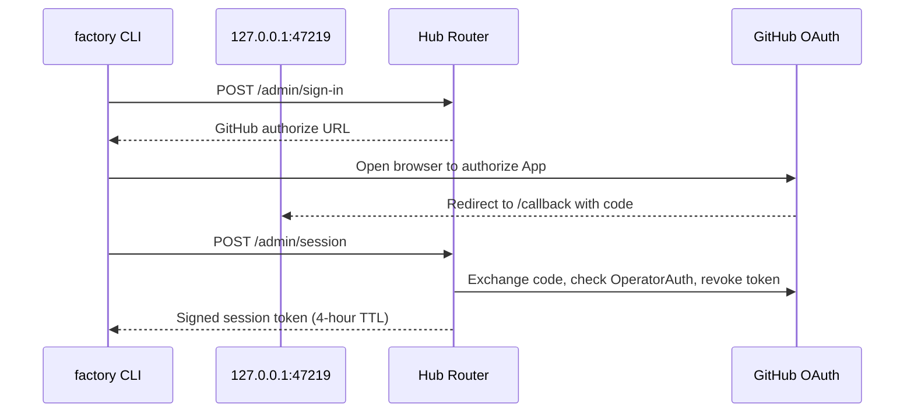

# CLI Reference

The `factory` CLI deploys and inspects Notation Factory hubs from your infrastructure repository and subscribes outpost repositories to them.

```sh [Terminal]
@pm.add("-g @notation/factory-cli")
```

Factory requires [Bun](https://bun.sh) on your `PATH`. Infrastructure commands run from the directory containing `factory.infra.ts`, while repository commands run anywhere inside an outpost repository containing `.factory/infra.ts`.

## Configuration files

Each repository type reads an optional TypeScript config file alongside its `infra.ts` entrypoint.

### Hub config (`factory.config.ts`)

Place `factory.config.ts` beside `factory.infra.ts` in your infrastructure repository:

```ts [factory.config.ts]
export default {
  loadEnv: "op run --env-file .env --",
  router: "https://acme--prod--router.your-subdomain.workers.dev",
};
```

| Field | Behavior |
| :--- | :--- |
| `loadEnv` | Command prefix executed before `factory infra up` and `factory infra down` |
| `router` | Hub router URL used by `factory infra status` and `factory infra replay` |

`factory infra up` prints the router URL when creating the router or when its URL changes.

### Outpost config (`.factory/config.ts`)

Place `.factory/config.ts` beside `.factory/infra.ts` in each subscribed repository:

```ts [.factory/config.ts]
export default {
  githubApps: { gh: 123456 },
  repo: "acme/webapp",
};
```

| Field | Behavior |
| :--- | :--- |
| `githubApps` | Maps each GitHub connection name in `.factory/infra.ts` to its numeric App ID |
| `repo` | Explicit `owner/name` override when the git `origin` remote points elsewhere |

The remote deployer evaluates `.factory/infra.ts` and ignores `.factory/config.ts`. Set `repo` when `.factory/` lives inside a subdirectory rather than the git repository root.

## Hub commands

Run `factory infra` commands from the root of your hub's infrastructure repository.

### `factory infra up`

Deploy or update the hub, write vault secrets, and trigger the router to redeploy all allowed repositories asynchronously:

```sh [Terminal]
factory infra up [--dry-run] [--credential <id>.<credential>@<hash>=<var>]
```

| Flag | Behavior |
| :--- | :--- |
| `--dry-run` | Prints planned infrastructure changes without modifying cloud resources |
| `--credential` | Supplies a manually rotated credential using `<id>.<credential>@<hash>=<var>` |

`factory infra up` uses your local cloud credentials and the router's sync key, so it requires no interactive operator sign-in once initial browser prompts complete.

### `factory infra status`

Sign in as an operator and print each repository's last deploy status, container build status, and any deliveries that failed in the last 7 days:

```sh [Terminal]
factory infra status
```

`factory infra status` queries the router directly and requires no cloud provider credentials.

### `factory infra replay`

Retry all failed deliveries from the last 7 days, or target one specific delivery by its `<connection>/<id>` identifier from `factory infra status`:

```sh [Terminal]
factory infra replay [<delivery>]
```

Replaying evaluates against each repository's current outpost configuration.

### `factory infra down`

Destroy the hub's Deployer, Router, outpost Workers, container applications, and vault secrets:

```sh [Terminal]
factory infra down
```

Protected external resources such as GitHub Apps are not deleted automatically; `factory infra down` opens their settings pages in your browser for manual cleanup.

## Repository commands

Run `factory repo` commands inside a subscriber repository with `.factory/infra.ts`. Both commands read GitHub metadata using `gh` or `GH_TOKEN`.

### `factory repo install`

Look up each GitHub App configured in `.factory/config.ts`, open its GitHub installation page for the repository, and wait up to 2 minutes for the hub to write `FACTORY_STATUS`:

```sh [Terminal]
factory repo install [--repo <owner/name>]
```

Pass `--repo <owner/name>` to override `.factory/config.ts` and the git `origin` remote. GitHub sends an installation event only for new installations – if the App is already installed on the repository, push a change under `.factory/` on the default branch instead.

### `factory repo status`

Fetch and print the repository's `FACTORY_STATUS` variable written by the hub:

```sh [Terminal]
factory repo status [--repo <owner/name>]
```

Exits with a non-zero code when the repository's last outpost deploy failed.

## Operator authentication

`factory infra status` and `factory infra replay` authenticate against the hub's router via GitHub OAuth rather than cloud provider credentials:



The CLI binds `http://127.0.0.1:47219/callback` to receive the OAuth callback, so port 47219 must be free during sign-in. Once verified against `github.OperatorAuth`, the router returns a signed session token valid for 4 hours.

Sessions are cached by router origin in `~/.config/notation-factory/sessions.json` with `0600` file permissions. The CLI reuses a cached session until 5 minutes before expiry and automatically re-authenticates if the router rejects a token.
