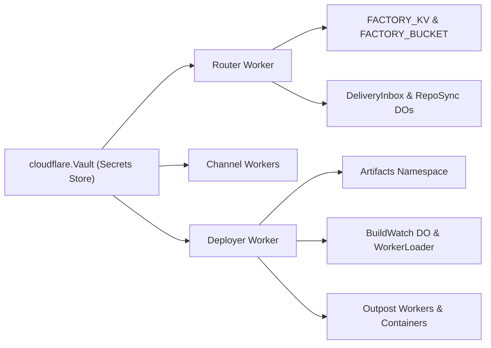

# Cloudflare Provider

`@notation/factory-cloudflare` runs a Notation Factory hub and its repository outposts on Cloudflare Workers, Durable Objects, KV, R2, Secrets Store, and Containers.

```sh [Terminal]
@pm.dev("@notation/factory @notation/factory-cloudflare @notation/factory-github @notation/factory-claude")
```

Declare `cloudflare.Vault`, `cloudflare.Router`, and `cloudflare.Deployer` in `factory.infra.ts`. Place your code host before the deployer so runner modules bundle at construction time.

```ts [factory.infra.ts]
import * as claude from "@notation/factory-claude";
import * as cloudflare from "@notation/factory-cloudflare";
import * as github from "@notation/factory-github";
import { sources } from "@notation/std/resources";

const vault = new cloudflare.Vault("vault");
const router = new cloudflare.Router("router", { vault });

const gh = new github.Connection("gh", { org: "acme", router });
new github.CodeHost("github", { connection: gh, allow: [{ owner: "acme" }] });
new github.OperatorAuth("operators", { connection: gh, users: ["alice"] });

const claudeToken = new sources.Env("claude-oauth-token", {
  config: { key: "CLAUDE_CODE_OAUTH_TOKEN", track: "scrypt" },
});
const claudeAccount = new claude.Account("claude", {
  auth: vault.secret({ id: "claude-oauth-token", value: claudeToken.credentials.value }),
});

new cloudflare.Deployer("deployer", {
  router,
  vault,
  accounts: [claudeAccount],
  accountId: "your-cloudflare-account-id",
  regions: ["WEUR"],
  sleepAfter: "10m",
});
```

## Authentication and tokens

Deploying and tearing down a Cloudflare hub uses two API tokens alongside your Cloudflare account login.

### Wrangler login vs `CLOUDFLARE_API_TOKEN`

Run `npx wrangler login` locally or export `CLOUDFLARE_API_TOKEN` for standard Workers, KV, R2, and Secrets Store resources. Creating the Artifacts namespace and deleting outpost Workers during deploy or teardown still requires that API token in the environment.

| Token scope | Required for |
| :--- | :--- |
| `Artifacts Edit` | Creating and deleting the Artifacts namespace |
| `Workers Scripts Edit` | Deleting outpost Workers during `factory infra down` |
| `Containers Edit` | Deleting outpost container applications during `factory infra down` |

### Interactive Builds token prompt

Cloudflare Workers Builds rejects account API tokens and requires a user API token. On the first `factory infra up`, Factory opens a local browser page with a pre-filled Cloudflare dashboard link requesting the seven required user permissions: Workers Scripts Edit, Containers Edit, Cloudchamber Edit, Workers CI Edit, Artifacts Read, Artifacts Edit, and Account Settings Read.

Once you create the token in Cloudflare and paste it into the local prompt, Factory verifies it, stores it in the vault, and binds it to the deployer Worker as `CLOUDFLARE_BUILDS_TOKEN`. When you later run `factory infra down`, Factory prints the token ID so you can revoke it from your Cloudflare profile.

## Vault and Secrets Store sharing

`new cloudflare.Vault(id)` provisions or attaches to your account's shared Cloudflare Secrets Store. Every Factory hub in the same Cloudflare account shares that single Secrets Store, while isolating secret entries by Notation application and stage.

Notation names each secret `<app>--<stage>--secret-<id>-<instance>`, adding an eight-character hex suffix. Secret values are write-only from outside Workers and cannot be read back through the API. Running `factory infra down` deletes only the current hub's prefixed secrets, leaving the store and other hubs untouched.

## Router and Deployer options

`cloudflare.Router` requires a `cloudflare.Vault` and an active `workers.dev` subdomain on the account. `cloudflare.Deployer` accepts these options alongside the router, vault, accounts, and optional secrets:

| Option | Behavior |
| :--- | :--- |
| `accountId` | Target account for outposts, defaulting to `CLOUDFLARE_ACCOUNT_ID` |
| `regions` | Region allowlist restricting where outpost containers start |
| `sleepAfter` | Idle timeout before stopping an inactive container |

The `sleepAfter` timeout defaults to `10m` and accepts seconds, minutes, or hours. When `regions` is omitted, Cloudflare starts containers near the incoming request.

Valid `regions` codes in `cloudflare.Deployer`:

| Code | Region |
| :--- | :--- |
| `ENAM` | Eastern North America |
| `WNAM` | Western North America |
| `EEUR` | Eastern Europe |
| `WEUR` | Western Europe |
| `APAC` | Asia-Pacific |
| `SAM` | South America |
| `ME` | Middle East |
| `OC` | Oceania |
| `AFR` | Africa |

## Hub services

A hub can run services for its containers. Each service is a Worker that `cloudflare.Service` binds to the router. Every container on the hub reaches the service at `http://<name>.factory`, with no credential, and the service gets each request with `x-factory-repo` and `x-factory-container`:

```ts [factory.infra.ts]
new cloudflare.Service("drafts", { router, worker: drafts });
```

See [Services](../authoring/services.md) for how to write one.

## Deployed hub resources

A Cloudflare hub spans shared routing infrastructure in your hub stage plus per-container outpost Workers provisioned dynamically as repositories subscribe.



Each component provisions dedicated Cloudflare resources scoped to your hub's app and stage:

| Component | Resources provisioned |
| :--- | :--- |
| `cloudflare.Vault` | Shared account Secrets Store and stage-scoped secret entries |
| `cloudflare.Router` | Router Worker, channel Workers, KV namespace, R2 bucket, `DeliveryInbox` and `RepoSync` Durable Objects |
| `cloudflare.Deployer` | Deployer Worker, `BuildWatch` Durable Object, `WorkerLoader` binding, Artifacts namespace, and outpost Workers |
| `cloudflare.Service` | A binding of the service's Worker on the router Worker |

For each container declared in an outpost's `.factory/infra.ts`, the deployer creates an Artifacts repository, pushes container sources, triggers Workers Builds, and hosts a Durable Object Container using the container's `instanceType` or `standard-1` by default.
