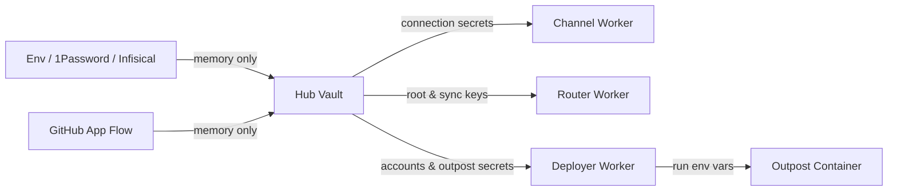

# Secrets

Notation Factory keeps plaintext credentials out of state, plans, and logs. During `factory infra up`, secrets move in process memory into the hub's write-only `Vault`, and each Worker binds only the secrets its role requires.

## Secret flow in a hub

Credentials enter the hub either from external secret sources or directly from platform setup flows, then flow outward only to authorized Workers and containers:



No component outside the hub can read secrets back from the vault. Containers never receive the hub's root key, channel secrets, or `FACTORY_CONTAINER_KEY` inside agent processes.

## Account secrets and sources

Declare runtime credentials with `sources.Env`, `sources.Dotenv`, or `InfisicalSecret`, then pass each credential reference to `vault.secret`:

```ts [factory.infra.ts]
import * as claude from "@notation/factory-claude";
import * as cloudflare from "@notation/factory-cloudflare";
import { sources } from "@notation/std/resources";

const vault = new cloudflare.Vault("vault");
const router = new cloudflare.Router("router", { vault });

const claudeToken = new sources.Env("claude-oauth-token", {
  config: { key: "CLAUDE_CODE_OAUTH_TOKEN", track: "scrypt" },
});

const claudeAccount = new claude.Account("claude", {
  auth: vault.secret({ id: "claude-oauth-token", value: claudeToken.credentials.value }),
});
```

Use `track` on `sources.Env` and `sources.Dotenv` to avoid rewriting unchanged secrets on every deploy:

| Track mode | Behavior |
| :--- | :--- |
| `undefined` | Rewrites the secret on every `factory infra up` |
| `"scrypt"` | Compares a salted scrypt hash in state |
| `"hmac"` | Compares a keyed HMAC-SHA256 hash using `NOTATION_TRACK_KEY` |

Use `"scrypt"` only for high-entropy generated credentials such as OAuth tokens or API keys. For human-chosen passwords or strings, use `"hmac"` and export the same `NOTATION_TRACK_KEY` on every machine and CI runner.

## Loading credentials with `loadEnv`

Add `loadEnv` to `factory.config.ts` to inject local credentials – such as provider tokens, runtime keys, or 1Password secrets via `op run` – before hub lifecycle commands run:

```ts [factory.config.ts]
export default {
  loadEnv: "op run --env-file .env --",
  router: "https://acme--prod--router.your-subdomain.workers.dev",
};
```

Factory prepends `loadEnv` when invoking the underlying Notation deploy command so your terminal remains attached for interactive browser prompts.

## Hub and GitHub App bindings

When `factory infra up` creates a GitHub App through the manifest flow, GitHub returns the App's private key and client secret once. Factory writes them straight to the vault in memory and isolates bindings by Worker role:

| Worker | Bound secrets |
| :--- | :--- |
| Router Worker | `FACTORY_ROOT_KEY` and `FACTORY_SYNC_KEY` |
| GitHub channel Worker | `ROOT_KEY`, `PRIVATE_KEY`, and `CLIENT_SECRET` |
| Deployer Worker | `FACTORY_ROOT_KEY`, `CLOUDFLARE_BUILDS_TOKEN`, account credentials, and `OUTPOST_<ID>` entries |

Neither the Router Worker nor the Deployer Worker binds `PRIVATE_KEY` or `CLIENT_SECRET`, and the Router Worker never binds account or outpost secrets.

## Outpost secrets

Use `OutpostSecret` from `@notation/factory` to pass repository-scoped credentials – such as staging database URLs or service tokens – into outpost containers as environment variables:

```ts [factory.infra.ts]
import { OutpostSecret } from "@notation/factory";
import { sources } from "@notation/std/resources";

const dbUrl = new sources.Env("web-db-url", {
  config: { key: "WEB_DATABASE_URL", track: "hmac" },
});

const webDatabase = new OutpostSecret("web-db", {
  name: "DATABASE_URL",
  value: dbUrl.credentials.value,
  allowedRepos: [{ owner: "acme", repo: "webapp" }],
});
```

Pass the array to `secrets` on `cloudflare.Deployer`. The `allowedRepos` field uses the same owner and repository pattern as `CodeHost`, so omitting the repository grants the secret to every allowed repository under that owner.

Deploy fails if two outpost secrets with overlapping repositories share an environment variable `name`, or if one collides with an `Account` secret. Because agents inside matching containers can read injected environment variables, scope each credential to least privilege.

## Losing or destroying the vault

Running `factory infra down` destroys the hub's vault secrets along with the Router and Deployer. On Cloudflare, `factory infra down` deletes only this hub's `<app>--<stage>--` secret entries and leaves the shared Secrets Store intact.

If vault secrets are deleted or you recreate a destroyed hub, `factory infra up` recovers them based on credential type:

| Credential type | Recovery behavior |
| :--- | :--- |
| External sources | Re-read automatically from `sources.Env`, `InfisicalSecret`, or `loadEnv` |
| Hub root key | Rotates automatically and re-derives webhook and container keys |
| GitHub App keys | Fails and prompts for manual rotation via `--credential` |
| Cloudflare Builds token | Fails and prompts for manual rotation via `--credential` |

Because GitHub and Cloudflare do not expose APIs to re-read or rotate an existing App's private key, client secret, or user API token, `factory infra up` halts and prints the exact `--credential` flag to pass. Generate a new key or secret on the provider's settings page, export it to a local environment variable, and re-run deploy:

```sh [Terminal]
export GH_PRIVATE_KEY="your-github-app-private-key"
factory infra up --credential gh-app.privateKey@<hash>=GH_PRIVATE_KEY
```

Pass `--credential` multiple times in a single `factory infra up` invocation when recovering both a private key and client secret together.
