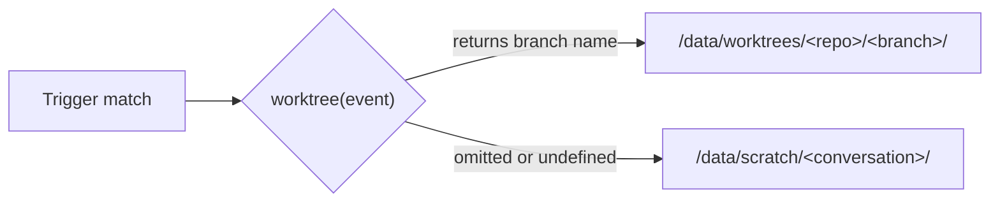

# Triggers & Worktrees

A `Trigger` connects a channel selector to an agent, a container, and an optional git branch function in Notation Factory. When a GitHub webhook arrives, the router verifies the signature and author permissions, saves the delivery durably, reacts on the thread, and dispatches the run into a serialized per-worktree queue with live progress updates.

## Declaring triggers

Declare a `Trigger` in `.factory/infra.ts` with its event selector, agent, container, and optional worktree routing:

```ts [.factory/infra.ts]
new Trigger("mention", {
  event: gh.issueComment({
    actions: ["created", "edited"],
    mention: "@claude",
    from: github.collaborators(),
  }),
  worktree: (event) => `issue-${event.issue.number}`,
  base: "main",
  agent: coder,
  container: dev,
});
```

| Field | Description |
| :--- | :--- |
| `event` | Required channel selector built with `gh.issue` or `gh.issueComment` |
| `agent` | Required `Agent` whose runtime is listed in `container.runtimes` |
| `container` | Required `Container` that hosts the run |
| `worktree` | Optional function returning a branch name string or `undefined` |
| `base` | Optional starting branch when creating a new worktree branch; requires `worktree` |

Setting `base` without `worktree` or targeting a container that lacks the agent's runtime throws when `.factory/infra.ts` is evaluated.

## GitHub event selectors

GitHub channels expose two selector builders: `gh.issue` for `issues` webhooks and `gh.issueComment` for `issue_comment` webhooks on both issues and pull requests.

| Selector | Supported actions |
| :--- | :--- |
| `gh.issue(opts)` | Defaults to `"opened"`; supports `"opened"`, `"edited"`, `"reopened"`, and `"labeled"` |
| `gh.issueComment(opts)` | Defaults to `"created"`; supports `"created"` and `"edited"` |

Both selectors accept four optional filters alongside the required `from` field:

| Filter | Behavior |
| :--- | :--- |
| `actions` | Array of webhook actions that match this trigger |
| `mention` | Case-insensitive handle matched at word boundaries; on `"edited"`, must be newly added |
| `listen` | Label that keeps a `mention` trigger listening on the issue; defaults to `listen:<mention without @>`; `false` turns it off |
| `labels` | Array of label names that must all be present on the issue, compared case-insensitively |
| `from` | Required author rule or array of author rules controlling who can start a run |

Mention matching follows GitHub handle boundaries, so `@claude` matches `@Claude` without matching longer usernames or email addresses. When watching `"edited"` events, Factory compares the previous body and fires only if the edit introduced the mention.

When a mention starts a run, the router adds the trigger's `listen` label to the issue or pull request. While the label is there, each new comment matches the trigger without the mention. These don't match:

- A comment that mentions another user, team or agent, such as `@bob` or `@droid`. It's addressed to them.
- An edit, unless it adds the mention.

Only a `gh.issueComment` trigger listens. On a `gh.issue` trigger, `listen` only names the label to add, so give the issue trigger and the comment trigger for an agent the same label. The default does this.

To stop the agent listening, remove the label. Removing a label needs triage access to the repo. The next mention adds the label again. Each agent has its own label, so a comment on an issue that several agents listen on starts a run for each of them.

## Author trust selectors

Every selector requires `from`. Pass a single rule or an array of rules built from `@notation/factory-github`:

| Selector | Behavior |
| :--- | :--- |
| `github.collaborators()` | Matches non-bot users with `admin`, `maintain`, or `write` permission on the repo |
| `github.user(login)` | Matches a specific non-bot GitHub login case-insensitively |
| `github.team(slug)` | Accepted in `.factory/infra.ts`, but not evaluated by the router yet |

Do not rely on `github.team(slug)` alone: the router does not resolve team memberships yet and skips triggers whose only match is a team check. Combine `team()` with `github.collaborators()` or `github.user(...)`, or use those selectors directly.

Bot accounts never match any `from` selector, and comments created by the hub's own GitHub App are ignored before matching so agent replies never trigger recursive loops.

## Branch worktrees vs scratch worktrees

When a trigger fires, the deployer evaluates `.factory/infra.ts` again in the isolated Worker Loader and calls the `worktree` function with the webhook payload without network access.



| Mode | Checkout behavior |
| :--- | :--- |
| Branch worktree | Restores saved bundle, checks out `origin/<branch>`, or cuts `<branch>` from `base` |
| Scratch worktree | Restores saved bundle, or detaches `HEAD` at `origin/<defaultBranch>` |

Branch worktrees live at `/data/worktrees/<repo>/<branch>/` and are shared across any trigger or conversation on the same container returning that branch name. Returned strings must be valid git branch names up to 200 characters without double dots, double slashes, trailing slashes, or `.lock` suffixes.

Scratch worktrees live at `/data/scratch/<conversation-slug>/` and are isolated per `(container, conversation)`. Leaving `worktree` undefined or returning `undefined` selects a scratch worktree.

## Queuing and duplicate handling

Factory deduplicates webhook retries and serializes concurrent worktree access across two layers:

1. **Webhook deduplication** – The router persists every matched delivery in a `DeliveryInbox` Durable Object keyed by connection and delivery ID before returning `202`. Duplicate deliveries from GitHub are ignored immediately.
2. **Per-worktree sequential lock** – Inside the container runner, runs acquire an in-memory lock keyed by `branch:<repo>:<branch>` for branch worktrees or `scratch:<conversation>` for scratch worktrees. Runs on different branches execute concurrently, while runs on the same worktree queue in order.

A queued run fetches thread messages from the router only when it leaves the queue and begins executing. If an earlier queued run already showed the same agent every current message body – and the run was not started by a non-message event such as `"labeled"` – the runner skips the redundant run silently without posting a duplicate reply.

## Live replies and progress

Before dispatching to a container, the router reacts with 👀 (`eyes`) on the triggering comment or issue opening post. As the agent runs:

- **Streaming edits** – The runner reads the agent's `stream-json` output, quotes the latest assistant text or `"Thinking..."` status, and edits a single reply comment at most once every 10 seconds while ignoring repeated identical text.
- **Elapsed clock** – Each progress edit appends a `<sub>` footer with the model name and duration, refreshing every 60 seconds when the agent is quiet.
- **Final replacement** – On completion, failure, or `SIGTERM` container shutdown, the runner edits that same comment with the final result or error. Runs time out after 2 hours.

Each posted comment begins with a hidden `<!-- factory:agent=<id> -->` marker so thread history attributes each reply to the agent that wrote it.

## Security and trust boundaries

On non-message `issues` events such as `"labeled"` or `"reopened"`, the router requires both the actor who performed the action and the issue's opening author to satisfy `from`, preventing an untrusted issue body from being triggered automatically by a label change.

When building prompts, Factory tags every thread message with its author, repository role, and `can_trigger_agent` boolean, escaping `<message` and `</message` tags inside message bodies so untrusted text cannot spoof message boundaries.

Two repository practices keep this boundary intact:

- **Scope policy permissions** – Avoid granting `issues: "write"` or `pull_requests: "write"` unnecessarily; any token that lets `gh` read raw issues or post directly via `gh issue view` or `gh api` bypasses the router's trust tags and `<!-- factory:agent=... -->` attribution.
- **Protect the default branch** – Require pull requests on the default branch in GitHub repository settings so an agent with `contents: "write"` cannot push changes directly to `.factory/` and redeploy its own outpost.

## Replaying failed deliveries

If a container is unreachable or its initial image build fails, the router edits its waiting message with the failure reason and preserves the delivery for 7 days. Operators inspect and replay failed dispatches from the hub repository:

```sh [Terminal]
factory infra status
factory infra replay
factory infra replay github/gh/<delivery-id>
```

`factory infra replay` re-dispatches failed triggers against the repository's current outpost configuration and mints fresh tokens. It also re-dispatches lost runs. Anyone in the trigger's `from` can restart a lost run from the link in its notice, without the CLI. See [Lost runs](./containers.md#lost-runs). See [CLI reference](../reference/cli.md) for operator sign-in and command flags.
