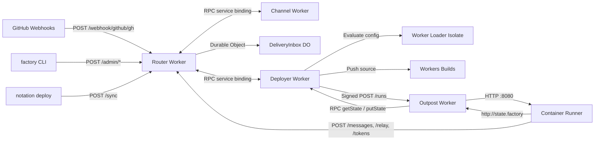

# Architecture

Notation Factory separates webhook routing and credentials in a central hub from agent execution in isolated per-container Workers. `@notation/factory` supplies the platform-independent routing, deployer evaluation, and container runner engines, while provider and platform plugins bind them to Cloudflare, GitHub, and agent CLIs.

## Control plane vs data plane

The hub keeps platform credentials out of container environments. Outpost containers receive short-lived clone and policy tokens per run rather than App private keys or account API tokens.

| Worker | Role and credentials |
| :--- | :--- |
| `Router` | Holds root and sync keys; reaches channel Workers, `Deployer`, and `DeliveryInbox` |
| `Channel` | Holds App private key, client secret, and webhook secret; reaches GitHub API and OAuth |
| `Deployer` | Holds root key, builds token, and account and outpost secrets; reaches Loader, Builds, R2, and KV |
| `Outpost` | Verifies signed runs via `Deployer` RPC; proxies state RPC and container HTTP traffic |

## Three runtime flows

Every interaction follows one of three paths through those Workers:

| Flow | Execution path |
| :--- | :--- |
| Deploy outpost | `push`, `installation`, or `POST /sync` evaluates `.factory/` in `WorkerLoader`, builds image, writes `FACTORY_STATUS` |
| Dispatch run | `issue` or `issue_comment` webhook verifies trust, stores in `DeliveryInbox`, resolves `worktree`, mints tokens, posts run |
| Execute and persist | Outpost `Container` alarm restores worktree and session, runs agent CLI, streams replies, snapshots back to R2 |

## Storage layout

On Cloudflare, the router and deployer share one KV namespace and one R2 bucket owned by the router.

### KV keys

| Key prefix | Stored value |
| :--- | :--- |
| `config` | Router configuration |
| `outposts/*` | Evaluated outpost configurations |
| `outpost-files/*` | Raw `.factory/` source snapshots |
| `deploys/*` | Last deploy status per repository |
| `builds/*` | Latest build state per container |
| `deliveries/failed/*` | Failed deliveries kept for 7 days |
| `outpost-workers/*` | Outpost Worker names per repository |
| `outpost-source/*` | Source hashes for build deduplication |
| `outpost-settings/*` | Deployer settings per hub |

### R2 object keys

| Object key | Stored artifact |
| :--- | :--- |
| `outposts/<containerId>/worktrees/*` | Incremental branch git bundles |
| `outposts/<containerId>/scratch/*` | Scratch worktree git bundles |
| `outposts/<containerId>/sessions/*` | Archived agent session transcripts and metadata |
