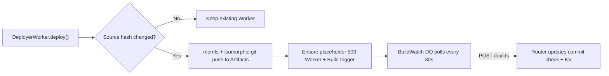

# Cloudflare Outpost Builds

Notation Factory provisions an isolated Cloudflare Worker and Durable Object Container for every `Container` declared in an outpost. Instead of embedding Factory runtime code in user repositories, the deployer commits synthesized build artifacts to Cloudflare Artifacts and monitors builds through `BuildWatch`.

## Deterministic naming and hashing

`outpostWorkerName` computes `<prefix>-<sha256(repo/container)[0..12]>` and collapses consecutive hyphens into single hyphens for the Cloudflare Container application name.

Before pushing, `deployOutposts` hashes the sorted generated files and executable paths, skipping builds whose `outpost-source/<worker>` KV entry already matches.

## Synthesized Artifacts repository

Using `isomorphic-git` over an in-memory `memfs` volume in `packages/cloudflare/workers/source-commit.ts`, the deployer pushes a single root commit on the main branch while preserving executable permissions:

| Path in Artifacts repo | Origin |
| :--- | :--- |
| `.factory/*` | Repository outpost files untouched |
| `factory-runtimes/<id>.sh` | Runtime `setup` scripts from bound `accounts` |
| `Dockerfile` | Container `image` or default Debian Dockerfile plus injected `factoryLayers` |
| `wrangler.json` | Worker and container config with `no_bundle`, `max_instances`, `regions`, and `sleepAfter` |
| `outpost.js` | Pre-bundled `outpost.gen.ts` hosting `OutpostContainer` |

Repository Dockerfiles only need project toolchains because `factoryLayers` appends the runtime environment in four steps:

- Switches to root and copies `bun` from `oven/bun:1-debian`.
- Installs `git` and CA certificates if missing.
- Executes each runtime setup script from `factory-runtimes/`.
- Drops to the non-root `factory` user with `HOME=/data/home` and exposes port 8080.

## Placeholder Workers and `BuildWatch`

If the Worker does not exist yet, `ensureWorker` uploads a placeholder returning HTTP 503 so `DeliveryInbox` waits instead of failing webhooks that arrive mid-build.

The deployer registers a `cloudflare_artifacts` build trigger running `npx wrangler deploy` with a user API token, since Workers Builds rejects account tokens, and records the build in `BuildWatch`.

`BuildWatch` polls the Cloudflare builds endpoint every 30 seconds for up to 2 hours (`GIVE_UP_MS`).

On status transitions, it posts a signed `BuildReport` to `/builds` and clears `outpost-source/<worker>` on failures so the next deploy retries.

## Cleanup and idle sleep

Removed containers have their outpost Worker, Cloudflare Container application, Artifacts repository, and KV hash deleted via `deleteOutpostWorker`.

At runtime, `OutpostContainer` checks the runner status endpoint inside `onActivityExpired`, preventing idle sleep while active runs remain even after `sleepAfter` elapses.
