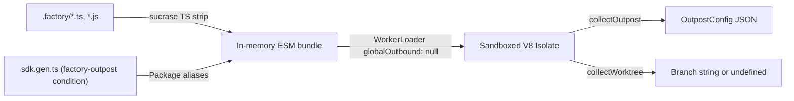

# Outpost Config Evaluation

Notation Factory compiles and runs each repository's `.factory/infra.ts` inside an isolated Cloudflare `WorkerLoader` with outbound networking disabled. This lets repositories declare dynamic TypeScript rules such as `worktree` callbacks without exposing hub secrets, tokens, or filesystem access.

## Outpost SDK build boundary

During build time, `scripts/build-sdk.ts` bundles six workspace packages using the `"factory-outpost"` export condition into `packages/factory/deployer/sdk.gen.ts` with a shared `@notation/resource` chunk:

| Package | Outpost exports |
| :--- | :--- |
| `@notation/factory` | `Container`, `Policy`, `Trigger`, contracts |
| `@notation/factory-github` | `Connection.get`, `Policy`, selectors |
| `@notation/factory-claude` | `Agent`, `runtime` |
| `@notation/factory-cursor` | `Agent`, `runtime` |
| `@notation/factory-droid` | `Agent`, `runtime` |
| `@notation/factory-slack` | `Connection`, selectors |

Sharing a single `@notation/resource` instance across the compiled modules ensures `OutpostGroup` registration tracks every declared resource in one collection graph.

## Module synthesis and sandboxing

When deploying an outpost or resolving a worktree in `packages/factory/deployer/index.ts`, `configModules` builds a virtual module map from the repository's `.factory/` directory:

- **Type stripping** – `sucrase` strips TypeScript syntax from `.ts` and `.mts` modules with `disableESTransforms` enabled, leaving JavaScript files untouched.
- **Directory aliases** – For each directory containing outpost files, `configModules` injects synthetic re-export modules pointing to the bundled SDK modules.
- **Network isolation** – `loaderContext` in `packages/cloudflare/workers/loader.ts` invokes `LOADER.get` with outbound networking disabled, an empty environment, and `nodejs_compat` enabled.

Because `OutpostGroup` records resources as side effects when `.factory/infra.ts` is imported, `loaderContext` appends a random UUID suffix to each isolate ID (`<sha256>:<uuid>`) so every evaluation runs a fresh module import.

## Deploy evaluation and error preservation

On deploy, the deployer invokes `collectOutpost` in `packages/factory/deployer/collect.ts`, defaults any unset channel `scope` to the repository name, and persists the config and raw source to KV only after container build scheduling succeeds.

Deleting `.factory/infra.ts` triggers `deleteOutpost` to remove the repository's outpost. If an edit fails evaluation, the previous valid outpost stays active and `FACTORY_STATUS` records a failed check.

## Runtime `worktree` callbacks

A `Trigger` omits its `worktree` callback from stored JSON config because functions are not serializable. During webhook dispatch, the router calls `deployer.worktree` with the repository, trigger ID, and delivery payload.

The deployer loads the stored `.factory/` snapshot into a fresh isolate, invokes `collectWorktree` with the payload, and validates the returned branch name using `isBranchName`.
