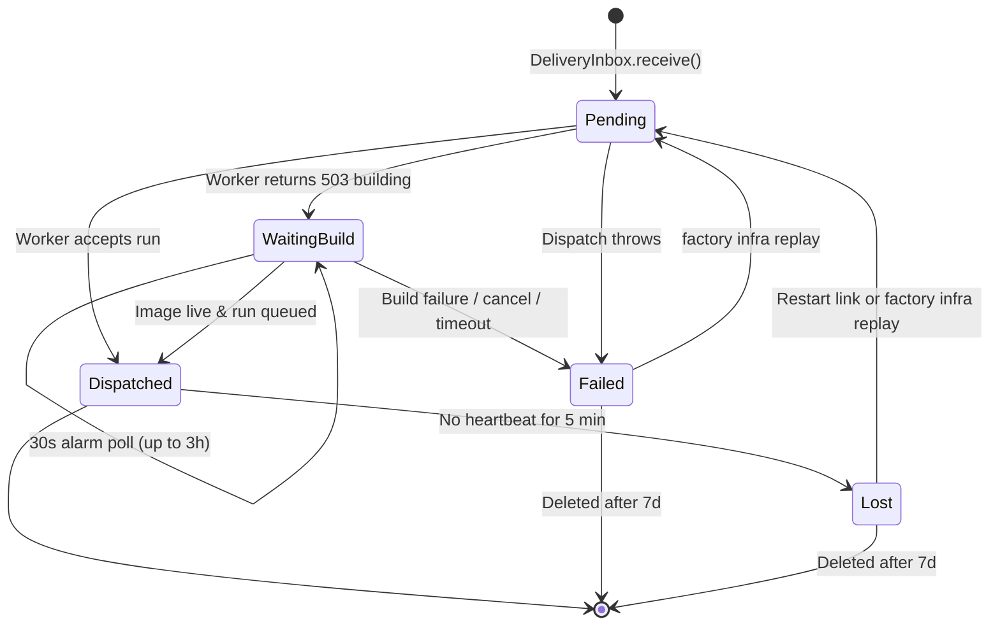

# Routing & Deliveries

Notation Factory routes HTTP traffic through `handle` in `packages/factory/router/handle.ts` and persists runnable webhooks inside Cloudflare's `DeliveryInbox` Durable Object before returning 202. A delivery survives router restarts and image build delays without minting tokens early or dropping events.

## Router endpoints

`handle` dispatches requests across webhook ingestion, container callbacks, build reporting, sync, and operator administration:

| Route | Caller and action |
| :--- | :--- |
| `POST /webhook/<key>` | Verifies delivery via channel Worker and enqueues runs or redeploys |
| `POST /relay` | Verifies `ReplyTicket` and optional message signature, then posts or edits the reply. Refuses replies from lost runs with 409 |
| `POST /messages` | Verifies `ReplyTicket` and fetches ordered thread messages |
| `POST /heartbeat` | Verifies `ReplyTicket` and records the run's heartbeat |
| `POST /tokens` | Verifies `TokenTicket` and refreshes container policy tokens |
| `POST /builds` | Verifies `BuildReport`, logs latest build, updates commit check |
| `POST /sync` | Syncs connection webhooks and queues allowed repositories |
| `GET /restart` | Checks a restart link and redirects to sign-in |
| `GET /restart/callback` | Signs the person in, checks them against `from`, and restarts the run |
| `GET /restart/started` | Confirms the restart, when the delivery has no URL to return to |
| `POST /admin/sign-in` | Starts GitHub OAuth sign-in for the `factory` CLI |
| `POST /admin/session` | Exchanges an OAuth code for a 4-hour operator session token |
| `GET /admin/repos` | Lists each repository's last deploy and container builds |
| `GET /admin/deliveries` | Lists failed deliveries retained in the inbox |
| `POST /admin/replay` | Re-queues failed deliveries with fresh run IDs |

## Webhook ingestion and deduplication

When a webhook hits `/webhook/<key>`, the router delegates signature checks and parsing to the connection's channel Worker:

- **Rejected or ignored** – Invalid signatures return 401; unhandled events or self-replies from the connection's App return 200 and start nothing.
- **Source changes** – Pushes to the default branch and App installation changes trigger `redeployEach` against the code host's `allow` list.
- **Accepted events** – Only triggers matching the channel, event, and scope whose author check returns `"allowed"` become pending dispatches.

Before responding 202, the router calls `store.inbox.receive(record)`. Because `DeliveryInbox` uses `idFromName("<connection>/<id>")` and checks whether a record exists, duplicate platform deliveries return 200 without creating duplicate runs.

## Alarm loop and build waiting

`DeliveryInbox` immediately arms an alarm to run `advance(record, store)`. On its first pass, `advance` executes four steps:

1. Acknowledges the triggering post once through the channel Worker.
2. Re-reads the current outpost configuration and resolves `deployer.worktree`.
3. Mints a fresh `cloneToken` and per-policy installation tokens.
4. Invokes `deployer.run(run)` to queue execution on the outpost container.

If an outpost container is still on its initial build, its placeholder Worker returns HTTP 503. On the first wait, `waitForBuild` posts a booting notice to the thread and schedules the next alarm 30 seconds later (`BUILD_POLL_MS`). Subsequent alarms skip token minting while `BuildWatch` reports a queued or active build.

`advance` and `watch` wait on the deployer and the channels, and a restart or replay can save the record during that wait. So the alarm saves the result of `mergeRecord`. The alarm only changes pending and dispatched dispatches, and a restart or replay only changes failed and lost ones, so the two never change the same dispatch.

The alarm must not block other calls while it waits on the deployer, because the outpost Worker posts the run's first heartbeat to this inbox before that call returns.

Any failure after resolving the conversation posts an error notice instructing operators to run `factory infra replay`. Once every dispatch settles, failed deliveries remain indexed in KV for 7 days (`KEEP_DELIVERY_MS`) before Durable Object cleanup. Operators can re-queue failed dispatches with fresh run IDs through `/admin/replay`.

## Heartbeats and lost runs

Factory sends a heartbeat for each run to `POST /heartbeat` every minute:

1. The outpost Worker sends the first heartbeat when it takes the run. It keeps sending them while it starts the container.
2. Once the runner has the run, the runner sends them, whether the run is queued or running.

The router starts watching a run at its first heartbeat. An outpost Worker built before heartbeats existed sends none, so its runs are never marked lost.

A reply posted with `done` ends the watch. The router records `done` only after the channel has posted the reply, so a failed final reply leaves the run watched. Heartbeats that arrive after `done` are ignored.

Once a heartbeat has started the watch, a reply without `done` counts as a heartbeat too. The router records the ID of the message that the reply posted, so the lost notice replaces that message even if the run stops before its next heartbeat. A heartbeat that names no message keeps the recorded ID.

The inbox alarm runs `watch` within 5 minutes (`LOST_AFTER_MS`) of each heartbeat. For each run with no heartbeat in the last 5 minutes, `watch`:

1. Marks the dispatch `lost`.
2. Replaces the run's message with a notice that has a restart link.
3. Lists the delivery as failed again, and keeps it for 7 more days.

A restart, from the link or from `factory infra replay`, gives the dispatch a new run ID. The router treats the old ID as lost too (`isLost`). If the old run's runner comes back, the router answers its heartbeats with `lost` and its replies with 409, so it can't overwrite the notice. The runner then stops the old run.

## Restart links

A restart link is `<router>/restart?run=<token>`. The token is a signed ticket that names one run. It expires after 7 days (`KEEP_DELIVERY_MS`). See [Security & Tickets](./security-and-tickets.md#restart-links) for how it is signed.

1. `GET /restart` checks the token and that the run is still lost, then redirects to the channel's sign-in.
2. `GET /restart/callback` checks the token again and signs the person in.
3. The channel's `canTrigger` checks the person against the trigger's `from` in the current outpost config. GitHub uses the person's role on the repo. `team` entries don't match yet.
4. The inbox's `restart` sets that dispatch back to `pending` with a new run ID.
5. The router redirects to the issue or comment that started the run. If the delivery has no URL, it redirects to `GET /restart/started`. The redirect means a reload doesn't reuse the sign-in code.

The channel handles sign-in because the router doesn't know which platform a delivery came from.
