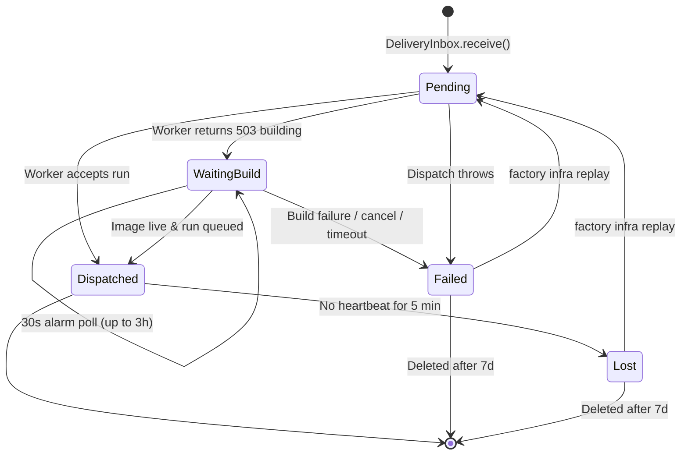

# Routing & Deliveries

Notation Factory routes HTTP traffic through `handle` in `packages/factory/router/handle.ts` and persists runnable webhooks inside Cloudflare's `DeliveryInbox` Durable Object before returning 202. A delivery survives router restarts and image build delays without minting tokens early or dropping events.

## Router endpoints

`handle` dispatches requests across webhook ingestion, container callbacks, build reporting, sync, and operator administration:

| Route | Caller and action |
| :--- | :--- |
| `POST /webhook/<key>` | Verifies delivery via channel Worker and enqueues runs or redeploys |
| `POST /relay` | Verifies `ReplyTicket` and optional message signature, posts or edits reply |
| `POST /messages` | Verifies `ReplyTicket` and fetches ordered thread messages |
| `POST /heartbeat` | Verifies `ReplyTicket` and optional message signature, notes the run's heartbeat in its `DeliveryInbox` |
| `POST /tokens` | Verifies `TokenTicket` and refreshes container policy tokens |
| `POST /builds` | Verifies `BuildReport`, logs latest build, updates commit check |
| `POST /sync` | Syncs connection webhooks and queues allowed repositories |
| `POST /admin/sign-in` | Starts GitHub OAuth sign-in for the `factory` CLI |
| `POST /admin/session` | Exchanges an OAuth code for a 4-hour operator session token |
| `GET /admin/repos` | Lists each repository's last deploy and container builds |
| `GET /admin/deliveries` | Lists failed deliveries retained in the inbox |
| `POST /admin/replay` | Re-queues failed deliveries with fresh run IDs |

## Webhook ingestion and deduplication

When a webhook hits `/webhook/<key>`, the router delegates signature checks and parsing to the connection's channel Worker:

- **Rejected or ignored** – Invalid signatures return 401; unhandled events or self-replies from the connection's App return 200 and start nothing.
- **Source changes** – Pushes to the default branch and App installation changes trigger `redeployEach` against the code host's `allow` list.
- **Accepted events** – Only triggers matching the channel, event, and scope whose author check returns `"allowed"` become pending dispatches.

Before responding 202, the router calls `store.inbox.receive(record)`. Because `DeliveryInbox` uses `idFromName("<connection>/<id>")` and checks whether a record exists, duplicate platform deliveries return 200 without creating duplicate runs.

## Alarm loop and build waiting

`DeliveryInbox` immediately arms an alarm to run `advance(record, store)`. On its first pass, `advance` executes four steps:

1. Acknowledges the triggering post once through the channel Worker.
2. Re-reads the current outpost configuration and resolves `deployer.worktree`.
3. Mints a fresh `cloneToken` and per-policy installation tokens.
4. Invokes `deployer.run(run)` to queue execution on the outpost container.

If an outpost container is still on its initial build, its placeholder Worker returns HTTP 503. On the first wait, `waitForBuild` posts a booting notice to the thread and schedules the next alarm 30 seconds later (`BUILD_POLL_MS`). Subsequent alarms skip token minting while `BuildWatch` reports a queued or active build.

Any failure after resolving the conversation posts an error notice instructing operators to run `factory infra replay`. Once every dispatch settles, failed deliveries remain indexed in KV for 7 days (`KEEP_DELIVERY_MS`) before Durable Object cleanup. Operators can re-queue failed dispatches with fresh run IDs through `/admin/replay`.

## Heartbeats and lost runs

The runner posts a heartbeat to `POST /heartbeat` once a minute for each run it holds, queued or running. The heartbeat carries the run's `ReplyTicket`, which names the delivery and the run, and the signed ID of the message that the run's replies replace. When the run finishes, the runner posts a last heartbeat with `done`, and the router stops watching the run.

The router saves each run's last heartbeat in the delivery's `DeliveryInbox`, under a key of its own, apart from the delivery record. The record is saved by the alarm after it calls the deployer and channels, so a heartbeat in the record could be overwritten.

Watching starts with a run's first heartbeat. A run that waits for its container's first image build, or for a free container instance, is not watched, because no runner holds it yet. A runner from before heartbeats never sends one, so its runs are never watched.

The alarm runs `watch` from `packages/factory/router/handle.ts` within 5 minutes (`LOST_AFTER_MS`) of each heartbeat. When a dispatched run's last heartbeat is 5 minutes old, `watch`:

1. Marks the dispatch `lost`, with an error that operators see in `factory infra status`.
2. Replaces the run's message on the thread with the lost notice, through the channel's `reply`. A run that had posted nothing has its lost notice posted as a new message.
3. Lists the delivery as failed again, and keeps it for 7 days from then.

`factory infra replay` dispatches lost runs again, like failed ones. The new run's first reply replaces the lost notice. If the lost run's runner is still alive and posts another heartbeat, the router answers `lost`, and the runner stops posting the run's replies, so they don't replace the notice.
