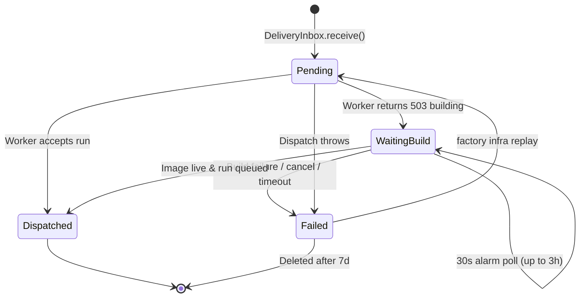

# Routing & Deliveries

Notation Factory routes HTTP traffic through `handle` in `packages/factory/router/handle.ts` and persists runnable webhooks inside Cloudflare's `DeliveryInbox` Durable Object before returning 202. A delivery survives router restarts and image build delays without minting tokens early or dropping events.

## Router endpoints

`handle` dispatches requests across webhook ingestion, container callbacks, build reporting, sync, and operator administration:

| Route | Caller and action |
| :--- | :--- |
| `POST /webhook/<key>` | Verifies delivery via channel Worker and enqueues runs or redeploys |
| `POST /relay` | Verifies `ReplyTicket` and optional message signature, posts or edits reply |
| `POST /messages` | Verifies `ReplyTicket` and fetches ordered thread messages |
| `POST /tokens` | Verifies `TokenTicket` and refreshes container policy tokens |
| `POST /builds` | Verifies `BuildReport`, logs latest build, updates commit check |
| `POST /sync` | Syncs connection webhooks and queues allowed repositories |
| `POST /admin/sign-in` | Starts GitHub OAuth sign-in for the `factory` CLI |
| `POST /admin/session` | Exchanges an OAuth code for a 4-hour operator session token |
| `GET /admin/repos` | Lists each repository's last deploy and container builds |
| `GET /admin/deliveries` | Lists failed deliveries retained in the inbox |
| `POST /admin/replay` | Re-queues failed deliveries with fresh run IDs |

## Webhook ingestion and deduplication

When a webhook hits `/webhook/<key>`, the router delegates signature checks and parsing to the connection's channel Worker:

- **Rejected or ignored** – Invalid signatures return 401; unhandled events or self-replies from the connection's App return 200 and start nothing.
- **Source changes** – Pushes to the default branch and App installation changes trigger `redeployEach` against the code host's `allow` list.
- **Accepted events** – Only triggers matching the channel, event, and scope whose author check returns `"allowed"` become pending dispatches.

Before responding 202, the router calls `store.inbox.receive(record)`. Because `DeliveryInbox` uses `idFromName("<connection>/<id>")` and checks whether a record exists, duplicate platform deliveries return 200 without creating duplicate runs.

## Alarm loop and build waiting

`DeliveryInbox` immediately arms an alarm to run `advance(record, store)`. On its first pass, `advance` executes four steps:

1. Acknowledges the triggering post once through the channel Worker.
2. Re-reads the current outpost configuration and resolves `deployer.worktree`.
3. Mints a fresh `cloneToken` and per-policy installation tokens.
4. Invokes `deployer.run(run)` to queue execution on the outpost container.

If an outpost container is still on its initial build, its placeholder Worker returns HTTP 503. On the first wait, `waitForBuild` posts a booting notice to the thread and schedules the next alarm 30 seconds later (`BUILD_POLL_MS`). Subsequent alarms skip token minting while `BuildWatch` reports a queued or active build.

Any failure after resolving the conversation posts an error notice instructing operators to run `factory infra replay`. Once every dispatch settles, failed deliveries remain indexed in KV for 7 days (`KEEP_DELIVERY_MS`) before Durable Object cleanup. Operators can re-queue failed dispatches with fresh run IDs through `/admin/replay`.
