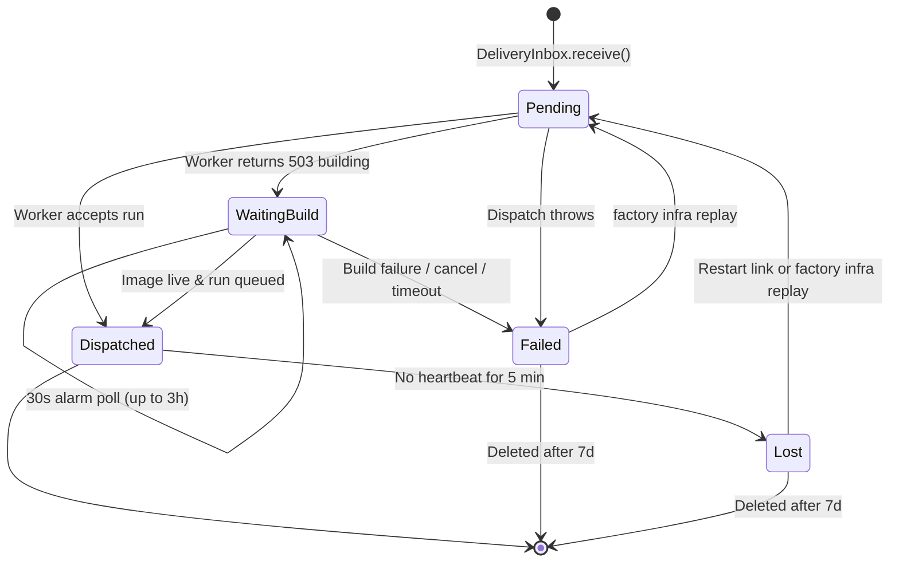

# Routing & Deliveries

Notation Factory routes HTTP traffic through `handle` in `packages/factory/router/handle.ts` and persists runnable webhooks inside Cloudflare's `DeliveryInbox` Durable Object before returning 202. A delivery survives router restarts and image build delays without minting tokens early or dropping events.

## Router endpoints

`handle` dispatches requests across webhook ingestion, container callbacks, build reporting, sync, and operator administration:

| Route | Caller and action |
| :--- | :--- |
| `POST /webhook/<key>` | Verifies delivery via channel Worker and enqueues runs or redeploys |
| `POST /relay` | Verifies `ReplyTicket` and optional message signature, refuses the reply of a lost run with 409, posts or edits reply, and stops watching the run after its last reply |
| `POST /messages` | Verifies `ReplyTicket` and fetches ordered thread messages |
| `POST /heartbeat` | Verifies `ReplyTicket` and optional message signature, notes the run's heartbeat in its `DeliveryInbox` |
| `POST /tokens` | Verifies `TokenTicket` and refreshes container policy tokens |
| `POST /builds` | Verifies `BuildReport`, logs latest build, updates commit check |
| `POST /sync` | Syncs connection webhooks and queues allowed repositories |
| `GET /restart` | Verifies a lost run's restart link and sends the browser to the channel's sign-in |
| `GET /restart/callback` | Signs the person in, checks them against the trigger's `from`, and restarts the lost run |
| `POST /admin/sign-in` | Starts GitHub OAuth sign-in for the `factory` CLI |
| `POST /admin/session` | Exchanges an OAuth code for a 4-hour operator session token |
| `GET /admin/repos` | Lists each repository's last deploy and container builds |
| `GET /admin/deliveries` | Lists failed deliveries retained in the inbox |
| `POST /admin/replay` | Re-queues failed deliveries with fresh run IDs |

## Webhook ingestion and deduplication

When a webhook hits `/webhook/<key>`, the router delegates signature checks and parsing to the connection's channel Worker:

- **Rejected or ignored** – Invalid signatures return 401; unhandled events or self-replies from the connection's App return 200 and start nothing.
- **Source changes** – Pushes to the default branch and App installation changes trigger `redeployEach` against the code host's `allow` list.
- **Accepted events** – Only triggers matching the channel, event, and scope whose author check returns `"allowed"` become pending dispatches.

Before responding 202, the router calls `store.inbox.receive(record)`. Because `DeliveryInbox` uses `idFromName("<connection>/<id>")` and checks whether a record exists, duplicate platform deliveries return 200 without creating duplicate runs.

## Alarm loop and build waiting

`DeliveryInbox` immediately arms an alarm to run `advance(record, store)`. On its first pass, `advance` executes four steps:

1. Acknowledges the triggering post once through the channel Worker.
2. Re-reads the current outpost configuration and resolves `deployer.worktree`.
3. Mints a fresh `cloneToken` and per-policy installation tokens.
4. Invokes `deployer.run(run)` to queue execution on the outpost container.

If an outpost container is still on its initial build, its placeholder Worker returns HTTP 503. On the first wait, `waitForBuild` posts a booting notice to the thread and schedules the next alarm 30 seconds later (`BUILD_POLL_MS`). Subsequent alarms skip token minting while `BuildWatch` reports a queued or active build.

Any failure after resolving the conversation posts an error notice instructing operators to run `factory infra replay`. Once every dispatch settles, failed deliveries remain indexed in KV for 7 days (`KEEP_DELIVERY_MS`) before Durable Object cleanup. Operators can re-queue failed dispatches with fresh run IDs through `/admin/replay`.

## Heartbeats and lost runs

The outpost Worker's `OutpostContainer.run` posts a run's first heartbeat to `POST /heartbeat` as soon as it takes the run, before it answers the deployer. While it starts the run's container or waits for a free instance, `OutpostContainer.deliver` posts the run's heartbeats with the same ticket, and those of the other runs that wait for the same container. Once the runner holds the run, the runner posts them, once a minute for each run it holds, queued or running. Each heartbeat carries the run's `ReplyTicket`, which names the delivery and the run, and the signed ID of the message that the run's replies replace.

A run is watched from its first heartbeat. An outpost Worker or runner from before heartbeats sends none, so the router never marks its runs lost. A hub deploy has the deployer deploy every repo again, and the new outpost Worker changes each container's source, so every outpost Worker is built again. But the builds take minutes, and a build can fail and leave the old Worker, so the router doesn't assume that an outpost sends heartbeats.

A run's last reply ends its watch. The runner posts it to `POST /relay` with `done`, and once the channel has posted it, the router saves `{ done: true }` in place of the run's last heartbeat. If the reply fails, the run stays watched, and 5 minutes later the lost notice replaces the run's message. A run that ends without a reply, such as a run that the runner skips, posts a heartbeat with `done` instead. The outpost Worker's reply for a run that it couldn't deliver has `done` too.

The router saves each run's last heartbeat in the delivery's `DeliveryInbox`, under a key of its own, apart from the delivery record. `heartbeatWatch` in `packages/factory/router/deliveries.ts` decides what each heartbeat saves. After `{ done: true }`, the router ignores heartbeats of the run, so a heartbeat that arrives after the run's last reply doesn't start the watch again, and the run's final reply stays on the thread.

The alarm runs `watch` from `packages/factory/router/handle.ts` within 5 minutes (`LOST_AFTER_MS`) of each heartbeat. When a dispatched run's last heartbeat is 5 minutes old, `watch`:

1. Marks the dispatch `lost`, with an error that operators see in `factory infra status`.
2. Replaces the run's message on the thread with the lost notice, through the channel's `reply`. A run that had posted nothing has its lost notice posted as a new message. The notice has a restart link, and says that the person can mention the agent again instead.
3. Lists the delivery as failed again, and keeps it for 7 days from then.

`factory infra replay` dispatches lost runs again, like failed ones. The new run's first reply replaces the lost notice. The restart gives the dispatch a new run ID, so the delivery record no longer has the lost run, and the router still counts it as lost (`isLost`). The router answers `lost` to a heartbeat of a lost run, and refuses its replies with status 409 and `{ lost: true }`, so the lost run's runner can't replace the lost notice if it comes back. The runner then stops the run's agent, saves its work, and posts nothing more. The restarted run queues behind it in the worktree.

## Restart links

A lost notice's restart link is `<router>/restart?run=<token>`. The token is the ticket `{ connection, delivery, run, expires }` as base64url JSON, a dot, and the ticket's signature with the `router:restart` key. It expires after 7 days (`KEEP_DELIVERY_MS`), when the inbox deletes the delivery. A token can't be changed to name another run.

The router doesn't know which platform the delivery came from, so the channel of the token's connection signs the person in and checks them:

1. `GET /restart` checks the token, and redirects the browser to the channel's `signInUrl`, with the token as the OAuth state and `<router>/restart/callback` as the redirect. For GitHub, this is the connection's App's web sign-in, which operators use too.
2. GitHub sends the browser to `GET /restart/callback` with a code. The router checks the token again, and has the channel exchange the code for the person's login and ID with `signIn`.
3. The router reads the delivery from the inbox, and checks that the token's run is still `lost`.
4. The router reads the run's trigger from the repo's outpost config as it is now, and has the channel's `canTrigger` check the person against the trigger's `from`. For GitHub, a person matches `collaborators` if their role on the repo can push. A `team` doesn't match yet, since the router doesn't check teams.
5. The inbox's `restart` sets that dispatch to `pending` with a new run ID, the way `factory infra replay` does, and leaves the delivery's other dispatches as they are. The new run's first reply replaces the lost notice.

A second visit to the link finds the run no longer lost, and restarts nothing. The new run is dispatched like any other, so it checks again that the trigger matches the delivery and its author.
