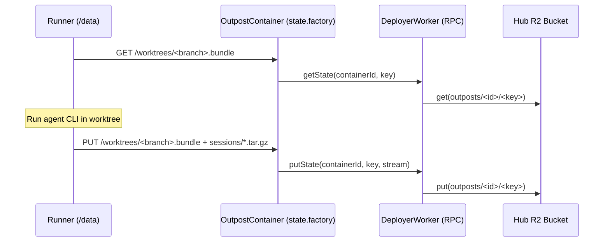

# Worktrees & Session State

Notation Factory containers use ephemeral `/data` disks that vanish whenever Cloudflare sleeps the instance. Every 60 seconds during a run, and again when it ends, `perform` (`packages/factory/runner/index.ts`) snapshots modified worktrees as incremental git bundles and archives per-agent transcript directories to R2 through `http://state.factory`.

## Container storage proxy (`state.factory`)

Outpost containers do not hold R2 credentials. Instead, `OutpostContainer.outboundByHost` in `packages/cloudflare/workers/outpost.ts` intercepts requests to `http://state.factory/<key>` via `@cloudflare/containers`.

The proxy validates keys against path traversal and forwards reads and streams to `DeployerWorker` under the `outposts/<containerId>/<key>` prefix.

## Git bundle worktree snapshots

The runner stores clones and active checkouts under `/data` using three path layouts:

| Path | Contents |
| :--- | :--- |
| `/data/repos/<slug(repo)>.git` | Bare repository clone updated via `git fetch --prune` |
| `/data/worktrees/<slug(repo)>/<branch>` | Checkout for branch-bound triggers |
| `/data/scratch/<slug(convId)>` | Detached scratch checkout per conversation |

`saveWorktree` runs every 60 seconds while the agent works, and once more when the run ends. It doesn't change the agent's staging area or history:

1. Copies the worktree's index into a temporary `GIT_INDEX_FILE` and runs `git add --all` to capture tracked, modified, and unignored untracked files.
2. Runs `git write-tree`. If the tree and `HEAD` haven't changed since the last save, it stops and uploads nothing.
3. Runs `git commit-tree` on top of `HEAD` to record an ephemeral commit under `refs/factory/worktrees/<branch>` or scratch refs.
4. Runs `git bundle create ... --not --remotes=origin` so the uploaded bundle contains only local commits and uncommitted changes relative to `origin`.

Only one save runs at a time. If a save is still going when the next one is due, the runner skips the next one. The final save waits for any save in progress. `FACTORY_SAVE_INTERVAL_MS` sets the interval.

On a cold container start, `restoreWorktree` fetches the snapshot commit from the bundle, adds the worktree at the parent commit, resets tracked and untracked state via `git read-tree` and `git reset`, and restores upstream tracking.

Gitignored build artifacts such as `node_modules` stay outside snapshot bundles and regenerate on demand.

## Per-agent config and session persistence

Runtimes that support relocating their configuration directory isolate state per agent ID under `/data/agents/<slug(agent.id)>/<configDir>`:

| Runtime | Config environment variable |
| :--- | :--- |
| `claude` | `CLAUDE_CONFIG_DIR` |
| `cursor` | `CURSOR_CONFIG_DIR` |
| `droid` | `FACTORY_HOME_OVERRIDE` |

Container `files` apply before agent `files`, routing matching home config paths into that isolated directory.

Runner stores session IDs, working directories, and seen message hashes in `/data/sessions/<conv>/<agent>.json`, scoped per agent so distinct runtimes never resume each other's sessions.

Each save uploads that file and a gzip tarball of the transcript files to `sessions/<conv>/<agent>.tar.gz`. It skips the upload if the transcript files haven't changed since the last save.

A new session's ID first appears in the CLI's output, so the runner reads it with the runtime's `session` function. Until then, saves during the run upload only the worktree.

Saves during a run keep the `seen` hashes from before the run. If the run is lost, the next run treats the lost run's messages as new and handles them again.
